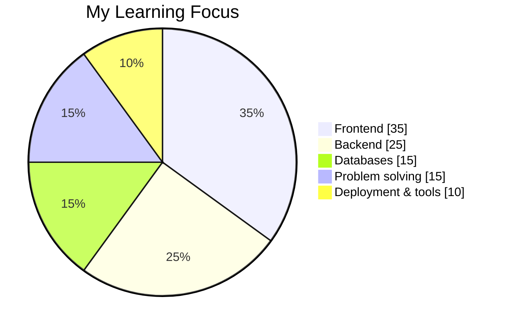
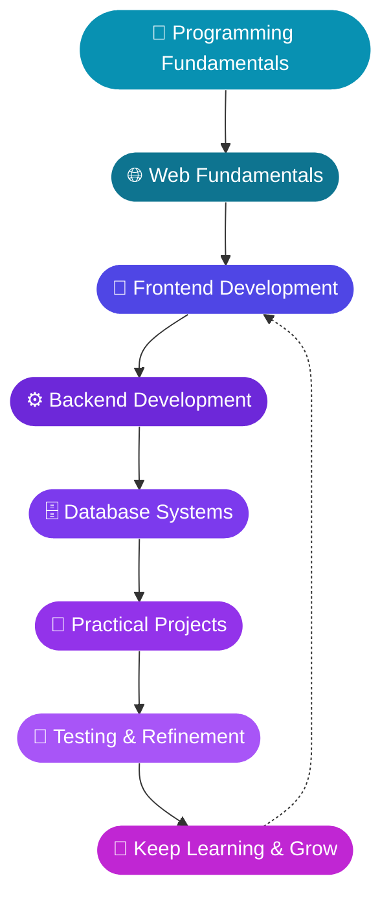
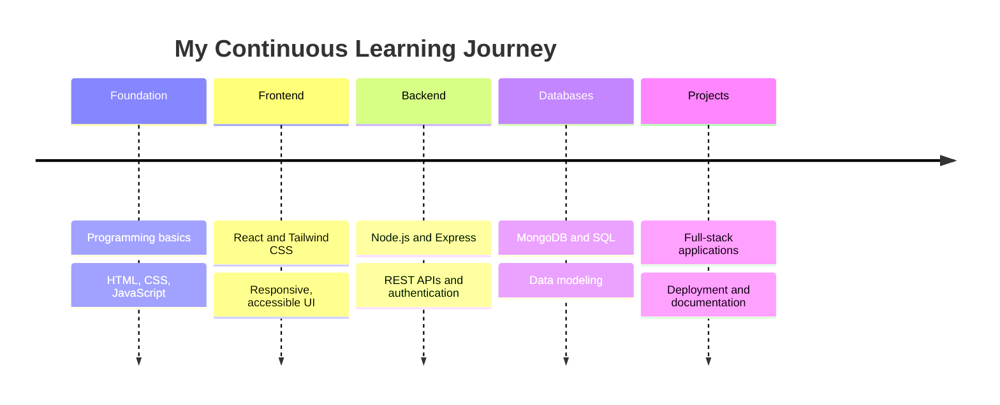

<!-- ORIGINAL BANNER — DO NOT REMOVE -->
<p align="center">
  
</p>

<div align="center">


### *Curiosity creates ideas. Code turns them into reality.*

<br/>

<a href="mailto:rakibhasanshuvo712@gmail.com?subject=Hello%20Rakib">
  
</a>
<a href="https://github.com/rakibhasanshuvo712-hub">
  
</a>
<a href="https://github.com/rakibhasanshuvo712-hub?tab=repositories">
  
</a>

<br/>


<a href="https://github.com/rakibhasanshuvo712-hub?tab=followers">
  
</a>
<a href="https://github.com/rakibhasanshuvo712-hub?tab=repositories">
  
</a>

<br/><br/>


</div>

---

## 📑 Quick Navigation

<div align="center">

[🧬 About](#-about-me) • [💻 Code Identity](#-my-code-identity) • [⚡ Tech Stack](#-technology-stack) • [🧰 Skills](#-skills--concepts) • [🚀 Projects](#-projects--repository-explorer) • [🔬 Exploring](#-what-im-exploring) • [📊 Analytics](#-github-analytics) • [🗺️ Roadmap](#%EF%B8%8F-developer-roadmap) • [🧠 Principles](#-my-development-principles) • [🤝 Contact](#-contact-me)

</div>

---

## 🧬 About Me

I'm **Rakib Hasan Shuvo**, a developer from Bangladesh 🇧🇩 interested in web development, programming, and creating useful digital experiences. I enjoy turning ideas into working products, one commit at a time.

| | |
| :-- | :-- |
| 🌱 **Currently learning** | Full-stack web development |
| 💻 **Interested in** | Frontend, backend, and database technologies |
| 🧠 **Mindset** | Learn the fundamentals and improve through practice |
| 🎯 **Goal** | Build practical projects and strengthen my development skills |
| 🤝 **Open to** | Collaboration, sharing knowledge, and learning from developers |

> ✨ **Learn something new. Build something useful. Improve something every day.**

---

## 💻 My Code Identity

```javascript
const rakib = {
  name: "Rakib Hasan Shuvo",
  from: "Bangladesh 🇧🇩",
  role: "Full-Stack Developer in Progress",
  learning: ["Frontend", "Backend", "Databases", "Real-world projects"],
  mindset: "Learn the fundamentals, improve through practice",
  currentGoal: "Build practical projects and keep growing",
  contact: "rakibhasanshuvo712@gmail.com",

  motto() {
    return "Learn. Build. Improve.";
  },
};
```

---

## ⚡ Technology Stack

<div align="center">

### 💻 Programming Languages


### 🎨 Frontend Development


### ⚙️ Backend Development


### 🗄️ Databases


### 🛠️ Tools & Platforms


<br/>

### 🏷️ Quick Badge View


</div>

---

## 🧰 Skills & Concepts

<table>
<tr>
<td width="50%" valign="top">

### 🎨 Frontend
- HTML5 semantic structure and accessibility
- CSS3: Flexbox, Grid, animations, responsive design
- Tailwind CSS and component libraries
- JavaScript (ES6+): DOM, events, async/await, fetch
- React: components, props, state, hooks
- React Router and client-side routing
- Context API and global state management
- Data fetching and caching with TanStack Query
- Forms, validation and user feedback
- Next.js and TypeScript fundamentals

</td>
<td width="50%" valign="top">

### ⚙️ Backend
- Node.js runtime and npm ecosystem
- Express.js: routing, middleware, REST APIs
- MongoDB and Mongoose data modeling
- CRUD operations and query design
- Authentication: Firebase Auth, JWT, protected routes
- Environment variables and secure configuration
- CORS, cookies, and API security basics
- Payment and third-party API integration
- Error handling and API testing with Postman

</td>
</tr>
<tr>
<td width="50%" valign="top">

### 🧩 Programming Fundamentals
- Problem-solving and debugging
- Data structures and algorithms basics
- Object-oriented thinking
- Clean, readable, maintainable code
- Reading documentation efficiently

</td>
<td width="50%" valign="top">

### 🛠️ Workflow & Deployment
- Git, GitHub, branching and pull requests
- Linux command line basics
- Deploying frontend and backend apps (Vercel, Netlify)
- Responsive and cross-browser testing
- Project documentation and README writing

</td>
</tr>
</table>

---

## 🚀 Projects & Repository Explorer

Explore my actual repositories, programming experiments, and future projects.

<div align="center">

<a href="https://github.com/rakibhasanshuvo712-hub?tab=repositories">
  
</a>
<a href="https://github.com/rakibhasanshuvo712-hub?tab=stars">
  
</a>

</div>

<!--
FEATURED PROJECT CARDS
1. Replace REPO_NAME with your real repository name.
2. Then remove the comment start and end lines that wrap this block.

<div align="center">
<a href="https://github.com/rakibhasanshuvo712-hub/REPO_NAME">
  
</a>
</div>
-->

### 🏗️ Project Ideas I'm Working Towards

| Project type | What I'll practice |
| :-- | :-- |
| 🛒 E-commerce app | Cart logic, authentication, payments, admin dashboard |
| 📝 Blog / CMS | CRUD, rich content, user roles, database design |
| 🎓 Learning platform | Protected routes, REST APIs, progress tracking |
| 📊 Dashboard | Charts, data fetching, responsive layouts |
| 💬 Real-time app | WebSockets, state sync, notifications |

---

## 🔬 What I'm Exploring

| Area | Focus |
| :-- | :-- |
| 🌐 **Web development** | Responsive interfaces and user experiences |
| ⚙️ **Backend** | APIs, application logic, and server-side development |
| 🗃️ **Databases** | SQL, data modeling, and database integration |
| 🧩 **Programming** | Fundamentals, debugging, and problem-solving |
| ✨ **UI/UX** | Clear layouts and intuitive navigation |
| 🔐 **Security** | Authentication, authorization, safe API design |
| ☁️ **Deployment** | Hosting, environment config, and keeping apps online |



---

## 📊 GitHub Analytics

<div align="center">

<a href="https://github.com/rakibhasanshuvo712-hub">
  
</a>
<a href="https://github.com/rakibhasanshuvo712-hub">
  
</a>

### 🔥 Contribution Streak
<a href="https://github.com/rakibhasanshuvo712-hub">
  
</a>


</a>

</div>

<details>
<summary><b>📌 About these statistics</b></summary>

<br/>

These cards depend on free third-party services. Values may be cached, unavailable, or calculated differently from GitHub's own contribution display. Language distribution is an estimate of repository code, not a measurement of programming skill.

**If a card is blank:** wait a few minutes and refresh, because the service may be rate-limited. A new account with few public commits will also show small numbers at first.

</details>

---

## 🗺️ Developer Roadmap





<details>
<summary><b>🎯 Skills I want to strengthen</b></summary>

- Improve programming fundamentals.
- Create responsive and accessible interfaces.
- Understand backend APIs and server-side logic.
- Practice database design and queries.
- Improve Git and GitHub workflows.
- Build, test, document, and deploy useful projects.

</details>

---

## 🔄 My Daily Workflow

```bash
# 1. Learn something new
# 2. Build a small thing with it
# 3. Break it, debug it, fix it
# 4. Commit with a clear message
git add .
git commit -m "feat: add what I learned today"
git push origin main
# 5. Repeat tomorrow 🔁
```

---

## 🧠 My Development Principles

<div align="center">

| Icon | Principle |
| :-: | :-- |
| 🔍 | Stay curious and ask better questions. |
| 🧱 | Build strong technical foundations. |
| 🧪 | Experiment and learn from mistakes. |
| 🧹 | Write readable, maintainable code. |
| 🤝 | Share knowledge and collaborate. |
| 🔄 | Keep improving through practice. |

</div>

---

## 🤔 Fun Facts

<details>
<summary><b>Click to open</b></summary>

- 🇧🇩 I'm building my developer journey from Bangladesh.
- 🧪 I learn best by building small projects and breaking them.
- 🌙 Debugging is just a puzzle with a deadline.
- 🔁 My favorite loop: learn → build → improve.

</details>

---

## 🤝 Contact Me

<div align="center">

**Have a question or want to connect?**<br/>
The email button below opens a new message addressed to **rakibhasanshuvo712@gmail.com** in your email app.

<a href="mailto:rakibhasanshuvo712@gmail.com?subject=Hello%20Rakib%20Hasan%20Shuvo">
  
</a>
<a href="https://github.com/rakibhasanshuvo712-hub">
  
</a>
<a href="https://github.com/rakibhasanshuvo712-hub?tab=repositories">
  
</a>

<br/><br/>

### Thanks for visiting my GitHub profile! 💙
**Keep learning. Keep building. Keep moving forward.**


</div>

<!--
EXTERNAL SERVICE NOTES
Banner = your original image.
Typing text, skill icons, badges, visit counter, stats, streak, activity graph,
trophies and footer are external services. If one fails, test its URL
separately in a browser; it is usually that service being slow or rate-limited.
-->
