<!-- ORIGINAL BANNER — DO NOT REMOVE -->
<p align="center">
  
</p>

<div align="center">


### *Curiosity creates ideas. Code turns them into reality.*

<a href="mailto:rakibhasanshuvo712@gmail.com?subject=Hello%20Rakib">
  
</a>
<a href="https://github.com/rakibhasanshuvo712-hub?tab=repositories">
  
</a>
<a href="https://github.com/rakibhasanshuvo712-hub?tab=followers">
  
</a>

📍 **Bangladesh 🇧🇩** &nbsp;•&nbsp; 🌱 **Learning Full-Stack Web Dev** &nbsp;•&nbsp; 🤝 **Open to Collaboration**

</div>

---

<div align="center">

[🧬 About](#-about-me) · [🎯 Right Now](#-right-now) · [⚡ Stack](#-technology-stack) · [🧰 Skills](#-skills--concepts) · [🚀 Projects](#-projects) · [📊 Stats](#-github-analytics) · [🗺️ Roadmap](#%EF%B8%8F-developer-roadmap) · [❓ FAQ](#-faq) · [🤝 Contact](#-contact-me)

</div>

---

## 🧬 About Me

I'm **Rakib Hasan Shuvo**, a developer from Bangladesh 🇧🇩 interested in web development, programming, and creating useful digital experiences. I enjoy turning ideas into working products, one commit at a time.

> ✨ **Learn something new. Build something useful. Improve something every day.**

| | |
| :-- | :-- |
| 🌱 **Currently learning** | Full-stack web development |
| 💻 **Interested in** | Frontend, backend, and database technologies |
| 🧠 **Mindset** | Learn the fundamentals and improve through practice |
| 🎯 **Goal** | Build practical projects and strengthen my development skills |
| 🤝 **Open to** | Collaboration, sharing knowledge, and learning from developers |

---

## 🎯 Right Now

| 🔭 Focus | 🛠️ Practicing | 🌟 Aiming for |
| :-- | :-- | :-- |
| Full-stack web development | React, Node.js, Express, MongoDB | Real, deployed, documented projects |
| Strong fundamentals | Problem-solving and debugging | Clean, maintainable code |
| Better workflows | Git, GitHub, deployment | Shipping something every week |

```javascript
const rakib = {
  name: "Rakib Hasan Shuvo",
  from: "Bangladesh 🇧🇩",
  role: "Full-Stack Developer in Progress",
  learning: ["Frontend", "Backend", "Databases", "Real-world projects"],
  contact: "rakibhasanshuvo712@gmail.com",
  motto() {
    return "Learn. Build. Improve.";
  },
};
```

---

## ⚡ Technology Stack

<div align="center">


</div>

| Category | Technologies |
| :-- | :-- |
| 💻 **Languages** | C · Java · Python · JavaScript · TypeScript |
| 🎨 **Frontend** | HTML · CSS · Bootstrap · Tailwind CSS · React · Redux · Next.js · Vite |
| ⚙️ **Backend** | Node.js · Express · NestJS · Firebase |
| 🗄️ **Databases** | MongoDB · MySQL |
| 🛠️ **Tools** | Git · GitHub · Linux · VS Code · Postman · Figma · npm · Vercel · Netlify |

---

## 🧰 Skills & Concepts

<table>
<tr>
<td width="50%" valign="top">

### 🎨 Frontend
- HTML5 semantic structure and accessibility
- CSS3: Flexbox, Grid, animations, responsive design
- Tailwind CSS and component libraries
- JavaScript (ES6+): DOM, events, async/await, fetch
- React: components, props, state, hooks
- React Router and client-side routing
- Context API and global state management
- Data fetching and caching with TanStack Query
- Forms, validation and user feedback
- Next.js and TypeScript fundamentals

</td>
<td width="50%" valign="top">

### ⚙️ Backend
- Node.js runtime and npm ecosystem
- Express.js: routing, middleware, REST APIs
- MongoDB and Mongoose data modeling
- CRUD operations and query design
- Authentication: Firebase Auth, JWT, protected routes
- Environment variables and secure configuration
- CORS, cookies, and API security basics
- Payment and third-party API integration
- Error handling and API testing with Postman

</td>
</tr>
<tr>
<td width="50%" valign="top">

### 🧩 Programming Fundamentals
- Problem-solving and debugging
- Data structures and algorithms basics
- Object-oriented thinking
- Clean, readable, maintainable code
- Reading documentation efficiently

</td>
<td width="50%" valign="top">

### 🛠️ Workflow & Deployment
- Git, GitHub, branching and pull requests
- Linux command line basics
- Deploying frontend and backend apps
- Responsive and cross-browser testing
- Project documentation and README writing

</td>
</tr>
</table>

<details>
<summary><b>✅ My learning checklist (tick items as I go)</b></summary>

<br/>

- [ ] Responsive layouts with Flexbox and Grid
- [ ] JavaScript async code and API calls
- [ ] React components, hooks and routing
- [ ] Build a REST API with Express
- [ ] Model data with MongoDB
- [ ] Add authentication to an app
- [ ] Deploy a full-stack project
- [ ] Write a clear README for every project

</details>

---

## 🚀 Projects

Explore my actual repositories, programming experiments, and future projects.

<div align="center">

<a href="https://github.com/rakibhasanshuvo712-hub?tab=repositories">
  
</a>
<a href="https://github.com/rakibhasanshuvo712-hub?tab=stars">
  
</a>

</div>

<!--
FEATURED PROJECT CARDS
1. Replace REPO_NAME with your real repository name.
2. Then remove the comment start and end lines that wrap this block.

<div align="center">
<a href="https://github.com/rakibhasanshuvo712-hub/REPO_NAME">
  
</a>
</div>
-->

### 🏗️ Project Ideas I'm Working Towards

| Project | What I'll practice |
| :-- | :-- |
| 🛒 **E-commerce app** | Cart logic, authentication, payments, admin dashboard |
| 📝 **Blog / CMS** | CRUD, rich content, user roles, database design |
| 🎓 **Learning platform** | Protected routes, REST APIs, progress tracking |
| 📊 **Dashboard** | Charts, data fetching, responsive layouts |
| 💬 **Real-time app** | WebSockets, state sync, notifications |

---

## 🔬 What I'm Exploring

| Area | Focus |
| :-- | :-- |
| 🌐 **Web development** | Responsive interfaces and user experiences |
| ⚙️ **Backend** | APIs, application logic, and server-side development |
| 🗃️ **Databases** | SQL, data modeling, and database integration |
| 🧩 **Programming** | Fundamentals, debugging, and problem-solving |
| ✨ **UI/UX** | Clear layouts and intuitive navigation |
| 🔐 **Security** | Authentication, authorization, safe API design |
| ☁️ **Deployment** | Hosting, environment config, keeping apps online |

---

## 📊 GitHub Analytics

<div align="center">

<a href="https://github.com/rakibhasanshuvo712-hub">
  
</a>
<a href="https://github.com/rakibhasanshuvo712-hub">
  
</a>

<a href="https://github.com/rakibhasanshuvo712-hub">
  
</a>

<a href="https://github.com/rakibhasanshuvo712-hub">
  
</a>

</div>

<details>
<summary><b>🏆 Profile trophies</b></summary>

<div align="center">

<a href="https://github.com/rakibhasanshuvo712-hub">
  
</a>

</div>

</details>

<details>
<summary><b>📌 About these statistics</b></summary>

<br/>

These cards depend on free third-party services. Values may be cached, unavailable, or calculated differently from GitHub's own contribution display. Language distribution is an estimate of repository code, not a measurement of programming skill. If a card is blank, refresh after a few minutes.

</details>

---

## 🗺️ Developer Roadmap

```mermaid
flowchart LR
    A([🧩 Fundamentals]) --> B([🌐 Web Basics])
    B --> C([🎨 Frontend])
    C --> D([⚙️ Backend])
    D --> E([🗄️ Databases])
    E --> F([🚀 Projects])
    F --> G([🧪 Testing])
    G --> H([🔄 Keep Growing])
    style A fill:#0891B2,color:#fff,stroke:none
    style B fill:#0E7490,color:#fff,stroke:none
    style C fill:#4F46E5,color:#fff,stroke:none
    style D fill:#6D28D9,color:#fff,stroke:none
    style E fill:#7C3AED,color:#fff,stroke:none
    style F fill:#9333EA,color:#fff,stroke:none
    style G fill:#A855F7,color:#fff,stroke:none
    style H fill:#C026D3,color:#fff,stroke:none
```



<details>
<summary><b>🎯 Skills I want to strengthen</b></summary>

<br/>

- Improve programming fundamentals.
- Create responsive and accessible interfaces.
- Understand backend APIs and server-side logic.
- Practice database design and queries.
- Improve Git and GitHub workflows.
- Build, test, document, and deploy useful projects.

</details>

---

## 🔄 My Daily Workflow

```bash
# 1. Learn something new
# 2. Build a small thing with it
# 3. Break it, debug it, fix it
git add .
git commit -m "feat: add what I learned today"
git push origin main
# 4. Repeat tomorrow 🔁
```

---

## 🧠 My Development Principles

| | Principle | | Principle |
| :-: | :-- | :-: | :-- |
| 🔍 | Stay curious and ask better questions | 🧹 | Write readable, maintainable code |
| 🧱 | Build strong technical foundations | 🤝 | Share knowledge and collaborate |
| 🧪 | Experiment and learn from mistakes | 🔄 | Keep improving through practice |

---

## 🤝 Let's Work Together

I'm happy to collaborate on:

- 🌐 Small web projects and open-source contributions
- 🧪 Practice projects, code reviews and learning partnerships
- 💡 Ideas that solve real problems for real people

---

## ❓ FAQ

<details>
<summary><b>What are you learning right now?</b></summary>

<br/>Full-stack web development: frontend, backend, databases and deployment.

</details>

<details>
<summary><b>How can I contact you?</b></summary>

<br/>Email me at **rakibhasanshuvo712@gmail.com** or open an issue on any of my repositories.

</details>

<details>
<summary><b>Are you open to collaboration?</b></summary>

<br/>Yes. I enjoy learning from other developers and building together.

</details>

---

## 🤝 Contact Me

<div align="center">

**Have a question or want to connect?**<br/>
The button below opens a new email addressed to **rakibhasanshuvo712@gmail.com** in your email app.

<a href="mailto:rakibhasanshuvo712@gmail.com?subject=Hello%20Rakib%20Hasan%20Shuvo">
  
</a>
<a href="https://github.com/rakibhasanshuvo712-hub">
  
</a>

<br/><br/>

### Thanks for visiting my GitHub profile! 💙
**Keep learning. Keep building. Keep moving forward.**


</div>

<!--
PERFORMANCE NOTES
- External images were reduced from ~45 to ~18 requests.
- Skill icons are one combined image instead of many.
- Stats cards use cache_seconds to load faster on repeat visits.
- Trophies are inside a collapsed section.
- First visit after a long gap can still be slow because free services wake up.
-->
